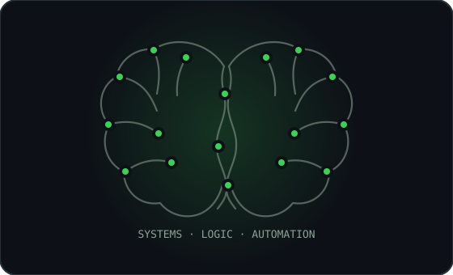
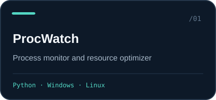

<table width="100%">
  <tr>
    <td width="38%" valign="top">
      <h3>01 / SYSTEM PROFILE</h3>
      
<strong>Orhan Doğan Kaplan</strong> IT Systems and Technologies student · Türkiye

      
Building practical Python tools for Windows, automation, and everyday workflows.

      
<strong>Currently building</strong> <a href="https://github.com/orhandogankaplan/CursorForge">CursorForge</a> — a Windows cursor customizer with 100+ styles.

      
<strong>Learning</strong> Linux · Networking · Cybersecurity fundamentals

      
<a href="https://dev.to/orhandogankaplan">DEV Community</a> · <a href="https://instagram.com/orhandkaplan">Instagram</a>

    </td>
    <td width="62%" valign="top">
      <h3 align="center">02 / CONTRIBUTION MATRIX</h3>
      

        <picture>
          <source media="(prefers-color-scheme: dark)" srcset="https://raw.githubusercontent.com/orhandogankaplan/orhandogankaplan/output/github-contribution-grid-snake-dark.svg" />
          <source media="(prefers-color-scheme: light)" srcset="https://raw.githubusercontent.com/orhandogankaplan/orhandogankaplan/output/github-contribution-grid-snake.svg" />
          
        </picture>
      

      

        
        
        
      

    </td>
  </tr>
</table>

<h3 align="center">03 / ACTIVITY OVER TIME</h3>

<table width="100%">
  <tr>
    <td width="50%" valign="middle"></td>
    <td width="50%" valign="middle">
      <h3>04 / CURRENT FOCUS</h3>
      
<code>Python</code> &nbsp; <code>Automation</code> &nbsp; <code>Windows tools</code>

      
Small, useful software. Clear interfaces. Safe system-level behavior.

      
<a href="https://github.com/orhandogankaplan?tab=repositories">Explore all repositories →</a>

    </td>
  </tr>
</table>

<h3 align="center">05 / SELECTED PROJECTS</h3>

<table width="100%">
  <tr>
    <td width="50%"></td>
    <td width="50%"></td>
  </tr>
  <tr>
    <td width="50%"></td>
    <td width="50%"></td>
  </tr>
</table>

Build · Learn · Improve

