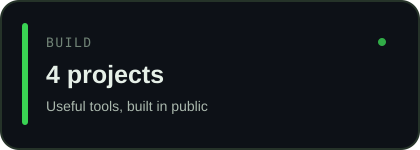
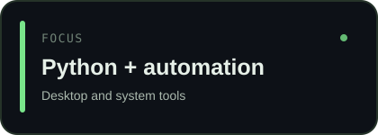
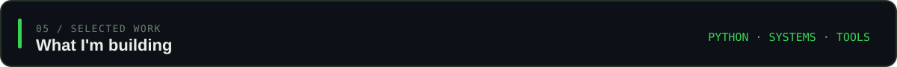
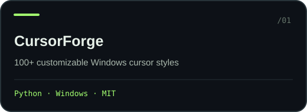
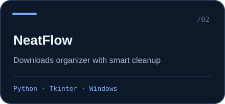

 
<picture><source media="(prefers-color-scheme: dark)" srcset="https://raw.githubusercontent.com/orhandogankaplan/orhandogankaplan/output/github-contribution-grid-snake-dark.svg" /><source media="(prefers-color-scheme: light)" srcset="https://raw.githubusercontent.com/orhandogankaplan/orhandogankaplan/output/github-contribution-grid-snake.svg" /></picture> 
 
 
 

<a href="https://github.com/orhandogankaplan/price-drop-tracker">Price Drop Tracker</a> &nbsp;/&nbsp; <a href="https://dev.to/orhandogankaplan">DEV Community</a> &nbsp;/&nbsp; <a href="https://instagram.com/orhandkaplan">Instagram</a>

